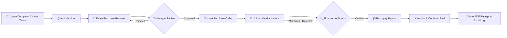

# ⚡ VyaparFlow

> **A Modern B2B Procurement & Vendor Payment SaaS Platform for Indian MSMEs**

---

## 📌 Overview

**VyaparFlow** is an end-to-end, multi-tenant B2B SaaS platform designed to transform how **Indian MSMEs (Micro, Small, and Medium Enterprises)** manage vendor procurement, invoice verification, and payout processing.

In traditional Indian business setups, procurement relies heavily on informal WhatsApp messages, emails, manual spreadsheets, and phone calls. This results in **untracked expenses, delayed manager approvals, invoice mismatches, GST compliance risks, and zero auditability**.

VyaparFlow replaces fragmented manual communication with a unified, role-governed workflow that brings structure, transparency, and financial accountability to every step of the procurement cycle.

---

## 💡 Problem vs. Solution

| Traditional Procurement Chaos | The VyaparFlow Advantage |
| :--- | :--- |
| 📲 Informal requests via WhatsApp & verbal calls | 📝 Centralized **Purchase Requests (PR)** with priority & itemized costs |
| 🤷 Unclear approval chains & missing records | 👔 Single-click **Manager Approvals** with recorded comments |
| 📑 POs created manually or skipped entirely | 📜 Auto-generated, immutable **Purchase Orders (POs)** |
| ⚠️ Manual invoice checks & tax oversight | 🔍 Structured **Invoice Verification** checking CGST, SGST, IGST tax splits |
| 🏦 Manual bank transfers decoupled from approvals | 💳 Webhook-verified **Razorpay Payments** linked directly to invoices |
| ❌ Missing audit trails during GST filings | 🛡️ Read-only **Audit Logs** tracking every financial state change |

---

## 🔄 The Complete Procurement Lifecycle

---

## 🌟 Key Features

### 🏢 Multi-Tenant Workspace & Company Management
- Each company operates within a completely isolated workspace.
- Admins can onboard their business, configure vendor catalogs, and invite team members via secure email invitations.

### 📝 Purchase Request (PR) Engine
- Procurement officers or admins can raise detailed purchase requests with department tags, itemized costs, priority levels (`NORMAL` / `URGENT`), and budget categories (`CAPEX` / `OPEX`).

### 👔 Streamlined Approval Workflow
- Dedicated review queues for Managers and Admins.
- Approvers can accept or reject PRs with detailed feedback notes, maintaining complete transparency before funds are committed.

### 📜 Immutable Purchase Orders (PO)
- Once a PR is approved, an official Purchase Order is generated and locked against editing to prevent unauthorized order alterations.

### 🔍 3-Way Invoice & Tax Verification
- Invoices are uploaded directly against issued POs.
- Finance teams verify vendor invoice numbers, dates, subtotal amounts, and GST splits (CGST, SGST, IGST) to ensure tax compliance before payment release.

### 💳 Webhook-Secured Razorpay Payments
- Integrated directly with Razorpay Checkout for seamless payment execution.
- Payment status transitions to `PAID` exclusively via signed Razorpay Webhooks—preventing client-side tampering or fraudulent confirmations.

### 📑 Automated PDF Payment Receipts
- Instant generation of downloadable, professional PDF payment receipts powered by `@react-pdf/renderer`.

### 🛡️ Enterprise Audit Logging & RBAC
- Immutable, read-only audit log tracking every action (PR approval, PO issuance, invoice verification, payment).
- Role-Based Access Control (RBAC) ensures users only access actions permitted for their role (`ADMIN`, `PROCUREMENT`, `MANAGER`, `FINANCE`).

---

## 👥 Role-Based User Workspace

VyaparFlow is built around real-world team hierarchies:

- **🛡️ Admin**: Workspace setup, team invitations, global analytics, and access to audit logs.
- **📦 Procurement**: Vendor onboarding, raising purchase requests, issuing purchase orders.
- **👔 Manager**: Reviewing pending PRs, approving/rejecting requests with audit comments.
- **💳 Finance**: Verifying uploaded vendor invoices, checking GST breakdowns, initiating Razorpay payments, downloading receipts.

> **Supplier Simplicity**: Vendors are treated as external entities (tracked via GSTIN, PAN, and Bank details). They do not need to register or log in, eliminating supplier friction.

---

## 🛠️ Tech Stack & Architecture

- **Frontend**: Next.js 16 (App Router), React 19, TypeScript, Tailwind CSS v4
- **UI & Analytics**: Radix UI Primitives, Lucide Icons, Recharts, Sonner Toasts
- **Database & ORM**: PostgreSQL, Prisma ORM 7 (`@prisma/adapter-pg`)
- **Authentication**: Better Auth (Multi-tenant session & workspace management)
- **Payment Processing**: Razorpay SDK + Webhook Verification
- **Document & Email**: `@react-pdf/renderer`, Nodemailer
- **AI Services**: Google Generative AI (`@google/generative-ai`)

---

## 💡 Engineering Highlights

- **Strict Tenant Isolation**: All queries and operations are scoped by `companyId` at the database level to guarantee zero cross-tenant data leaks.
- **Webhook Source of Truth**: Financial status is never trusted from the client browser—only cryptographic server webhooks confirm payment success.
- **GST & Audit Ready**: Built keeping Indian tax compliance, vendor GSTIN tracking, and payment aging in mind.

---

## 👤 Author

**Varun Sinha**  
*Full Stack Developer*  
- GitHub: [@VarunSinha07](https://github.com/VarunSinha07)

---

## 📄 License

This project is licensed under the MIT License.
